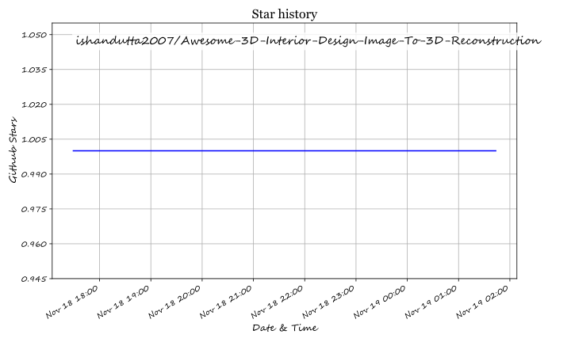

# Awesome-3D-Interior-Design-Image-To-3D-Reconstruction

# Awesome-3D-Interior-Design-Image-To-3D-Reconstruction

## Top 3D Interior Design & Image-to-3D Reconstruction Ecosystem

**Curated List of SaaS Products & Open-Source GitHub Projects**  

*Focused on 2D/3D Floor Plan Editors, Virtual Room Staging, Single-Image Room Reconstruction & Local 3D Furniture Synthesis*  

**Last updated: November 2026**

This repository tracks notable **SaaS platforms** and **open-source projects** for **3D Interior Design & Image-to-3D Reconstruction**. These tools empower interior designers, architects, real-estate developers, and AI engineers to draft 2D/3D floor plans, furnish interactive virtual rooms, reconstruct full 3D interior scenes from a single reference photograph, and generate PBR-textured 3D furniture assets.

**Examples** include Planner 5D, RoomSketcher, Foyr Neo, Cedreo, Floorplanner, Coohom, Autodesk Forma, SketchUp, Homestyler, and img2threejs/img2interior (the category leaders). 

**Open-source emphasis**: This section is heavily expanded with every major active project for local 2D/3D floor plan editors, AI agent room-to-Three.js/Blender reconstruction, single-image indoor scene decomposition, and local image-to-3D furniture modeling — ideal for architects, interior designers, creative developers, and spatial AI researchers building vendor-free pipelines.

Contributions welcome! Open a PR to add/update entries. Keep descriptions factual and link to official sites.

## Table of Contents

- [SaaS/Hosted Platforms](#saashosted-platforms)

- [Open-Source GitHub Projects](#open-source-github-projects)

- [How to Contribute](#how-to-contribute)

- [Disclaimer](#disclaimer)

## SaaS/Hosted Platforms

- **[Planner 5D & Planner 5D Pro](https://planner5d.com)**  

  Cloud-based 2D/3D home and interior design platform featuring AI floor plan recognition, Smart Wizard room layouts, 8,000+ furniture items, and photorealistic cloud renders.

- **[RoomSketcher](https://roomsketcher.com)**  

  Web and desktop floor plan and home design software offering instant 2D-to-3D conversion, Live 3D walkthroughs, 360-degree views, and high-resolution interior renders.

- **[Foyr Neo](https://foyr.com)**  

  Browser-native cloud interior design and 3D rendering platform providing AI-assisted floor planning, 60,000+ pre-modeled 3D furniture assets, and fast cloud ray-tracing.

- **[Cedreo](https://cedreo.com)**  

  Cloud 3D home design software built for remodelers, builders, and interior designers to draw floor plans, furnish interiors, and generate photorealistic renders in minutes.

- **[Floorplanner](https://floorplanner.com)**  

  Interactive web-based 2D/3D space planning and interior staging platform widely used in real estate for rapid room layouts and cloud visualization.

- **[Coohom](https://coohom.com)**  

  Cloud 3D interior design and enterprise spatial visualization suite offering AI room styling, custom cabinetry/parametric modeling, and 4K/8K cloud rendering.

- **[Autodesk Forma](https://autodesk.com)**  

  Cloud AI architectural planning and spatial design platform providing real-time environmental analyses (daylight, wind, microclimate) and seamless Revit/Rhino interoperability.

- **[SketchUp (Web & Studio)](https://sketchup.com)**  

  Industry-standard 3D architectural and interior modeling suite featuring 3D Warehouse, Trimble Connect cloud collaboration, and real-time visualization tools.

- **[Homestyler](https://homestyler.com)**  

  Cloud 3D interior design platform and furniture catalog supporting AI room photo-to-design restyling, custom floor plans, and browser-based cloud rendering.

## Open-Source GitHub Projects

- **[img2threejs/img2interior](https://github.com/img2threejs/plugin-interior)**  

  Open-source AI agent interior reconstruction skill for Claude Code, Codex, and OpenCode that inspects a single room photograph, authors an editable Blender scene, visually compares renders, and delivers an interactive Three.js web viewer (see [showcase media](https://github.com/img2threejs/img2interior-media)).

- **[Sweet Home 3D](https://sourceforge.net)**  

  Established open-source (`GPL-2.0`) desktop interior design application enabling users to trace imported floor plans, arrange 3D furniture catalogs, and navigate live 3D walkthroughs.

- **[3D-RE-GEN (`cgtuebingen/3D-RE-GEN`)](https://github.com/cgtuebingen/3D-RE-GEN)**  

  Open-source (`MIT`) single-image indoor scene reconstruction framework combining instance segmentation (Grounded-SAM), generative inpainting, 2D-to-3D asset synthesis (`Hunyuan3D-2.0`), and layout optimization.

- **[hazhirrashidi/floorplan-3d](https://github.com/hazhirrashidi/floorplan-3d)**  

  Offline-ready open-source 2D/3D home planner and Three.js walkthrough app with first-person navigation, interactive doors, sun-angle lighting, flooring cost estimators, and desktop Electron builds.

- **[Blueprint3D Modern (`charmlinn/blueprint3d-modern`)](https://github.com/charmlinn/blueprint3d-modern)**  

  Modern open-source (`MIT`) TypeScript rewrite of Blueprint3D built with Three.js and Next.js featuring 2D wall drawing, 3D furniture placement, texture customization, and local persistence.

- **[Arcada (`mehanix/arcada`)](https://github.com/mehanix/arcada)**  

  Open-source (`Apache-2.0`) cross-platform interior design and scaled floor plan creator built with React, Pixi.js, and MongoDB supporting multi-floor layouts and component libraries.

- **[AssetFurnace (`Bingeljell/image-to-3dlab`)](https://github.com/Bingeljell/image-to-3dlab)**  

  Complete open-source (`Apache-2.0`) local image-to-3D pipeline for Apple Silicon and NVIDIA GPUs unifying `TRELLIS.2`, `Hunyuan3D`, `SF3D`, and pixel-matched texture projection for furniture and prop assets.

- **[TripoSR (`VAST-AI-Research/TripoSR`)](https://github.com/vast-ai-research/triposr)**  

  Fast feed-forward open-source (`MIT`) single-image-to-3D reconstruction model developed with Stability AI that turns reference photos of chairs, tables, and decor into textured 3D meshes in under a second.

- **[Tencent Hunyuan3D-2](https://github.com)**  

  High-resolution open-source 3D asset generation system combining flow-based geometry diffusion and PBR texture synthesis with a native Blender add-on for interior visualization.

- **[Microsoft TRELLIS](https://github.com)**  

  Large-scale open-source (`MIT`) 3D generative model using Structured 3D Latents (SLAT) to reconstruct detailed 3D furniture and room props exportable as textured meshes or 3D Gaussians.

- **[Blender & Bonsai (BlenderBIM)](https://github.com)**  

  Flagship open-source (`GPL` / `LGPL`) 3D creation and native OpenBIM/IFC architectural modeling suite featuring Cycles path tracing, real-time EEVEE rendering, and Archimesh room generators.

- **[FreeCAD](https://github.com)**  

  Parametric open-source (`LGPL-2.0+`) 3D CAD/BIM modeler equipped with Arch and BIM workbenches for precision architectural floor plans, walls, windows, and technical drawings.

- **[Plan2Scene (`3dlg-hcvc`)](https://3dlg-hcvc.github.io/plan2scene/)**  

  Open-source research system that converts 2D architectural floor plans and sparse room photographs into textured, navigable 3D indoor scenes.

- **[SingleViewReconstruction (`DLR-RM`)](https://github.com)**  

  Open-source deep learning framework for holistic 3D indoor room layout, camera pose, and furniture mesh reconstruction from a single RGB image.

- **[3D-Room-Reconstruction (`MarcelHa97`)](https://github.com/MarcelHa97/3D-Room-Reconstruction)**  

  Open-source computer vision application for reconstructing calibrated 3D room models and multi-angle perspective views from 2D indoor photographs.

### Additional Strong Open-Source Options

- **[wy51ai/floorplan-3d](https://github.com/wy51ai/floorplan-3d)** and **[NeonPlan3D (`Mastershort/neonplan3d`)](https://github.com)** for lightweight, zero-build HTML/Three.js 2D-to-3D apartment layout and smart-home floor plan editors.

- **[Home3D 1.0](https://arxiv.org/html/2606.27923v2)** and **[PartCrafter](https://github.com)** for material-decomposed and part-segmented image-to-3D furniture and interior decor synthesis.

- **[That Open Engine (IFC.js)](https://github.com)** and **[xeokit BIM Viewer](https://github.com)** for browser-native WebGL architectural BIM/IFC inspection and section cuts.

- **[Poly Haven (3D Models & PBR Textures)](https://github.com)** and **[BlenderKit](https://github.com)** for CC0 architectural PBR materials, HDRI interior lighting environments, and furniture asset libraries.

- **[COLMAP](https://github.com)** and **[Nerfstudio](https://github.com)** for multi-photo photogrammetry and 3D Gaussian Splatting interior room capture.

**Frameworks for building custom systems**: Combine **img2threejs/img2interior** or **3D-RE-GEN** with **Blender (Bonsai BIM)**, **AssetFurnace (`TRELLIS.2` / `Hunyuan3D`)**, and **hazhirrashidi/floorplan-3d** for end-to-end local 3D interior design and image-to-3D room reconstruction pipelines.

## How to Contribute

1. Fork the repo.

2. Add/edit entries in `README.md` (follow existing format).

3. Include: name, link, 1–2 sentence description, and whether it's SaaS or open-source.

4. Submit PR with a short explanation.

Star the repo if you find it useful!

## Disclaimer

- This is a **community-curated** list — not exhaustive and not an endorsement.

## ⭐ Star History

<a href="https://star-history.com/#ishandutta2007/Awesome-3D-Interior-Design-Image-To-3D-Reconstruction&Timeline" align="center">
  <picture>
    <source media="(prefers-color-scheme: dark)" srcset="assets/ishandutta2007_Awesome-3D-Interior-Design-Image-To-3D-Reconstruction_growth.svg">
    
  </picture>
</a>
