<p align="center">
  
</p>

# 🏰 Awesome-3D-Interior-Design-Image-To-3D-Reconstruction

<p align="center">
  <a href="https://github.com/ishandutta2007/Awesome-Awesome-Awesome"></a><a href="https://discord.gg/jc4xtF58Ve"></a>
  <a href="https://github.com/ishandutta2007/Awesome-3D-Interior-Design-Image-To-3D-Reconstruction/stargazers"></a>
  <a href="https://github.com/ishandutta2007/Awesome-3D-Interior-Design-Image-To-3D-Reconstruction/network/members"></a>
  <a href="https://github.com/ishandutta2007/Awesome-3D-Interior-Design-Image-To-3D-Reconstruction/blob/main/LICENSE"></a>
  <a href="https://github.com/ishandutta2007"></a>
</p>

---

## 🌟 Top 3D Interior Design & Image-to-3D Reconstruction Ecosystem

> 📐 **Curated List of SaaS Platforms, Generative Spatial AI Models & Open-Source Repositories**  
> *Targeted for 2D/3D Floor Plan Editors, Virtual Room Staging, Single-Image Indoor Scene Reconstruction, Gaussian Splatting & Local 3D Furniture Synthesis.*  
> **Last updated: November 2026**

Welcome to the definitive, SEO-optimized, and community-maintained resource list covering **3D Interior Design**, **Computer Vision Scene Decomposition**, and **Image-to-3D Asset Generation**. Whether you are an interior architect drafting precision CAD floor plans, an AI researcher exploring Structured 3D Latents (SLAT) and neural radiance fields (NeRF/Gaussian Splatting), a prop-tech founder building real-estate virtual tours, or a creative developer creating WebGL/Three.js interactive walkthroughs, this repository tracks industry-leading hosted SaaS platforms and modern open-source codebases.

---

## 📑 Table of Contents

- [📊 Sector Overview & Market Dynamics](#-sector-overview--market-dynamics)
- [🏢 SaaS & Hosted Cloud Platforms](#-saas--hosted-cloud-platforms)
- [💻 Open-Source GitHub Projects](#-open-source-github-projects)
- [🛠️ Recommended Workflows & Architecture Stacks](#️-recommended-workflows--architecture-stacks)
- [🤝 How to Contribute](#-how-to-contribute)
- [❤️ Support & Sponsorship](#️-support--sponsorship)
- [📜 Disclaimer](#-disclaimer)
- [⭐ Star History](#-star-history)

---

## 📊 Sector Overview & Market Dynamics

The global **3D Interior Design and Architectural Visualization Software market** is valued at approximately **$7.2 billion** and is projected to surpass **$15.8 billion by the mid-2030s** at an estimated compound annual growth rate (CAGR) of **9.2%**. The broader Building Information Modeling (BIM) and spatial design landscape continues to witness exponential disruption fueled by single-image 3D foundation models, Gaussian splatting, and generative neural rendering.

Market structure in this sector is **moderately fragmented**: entrenched CAD and BIM titans (such as Autodesk and Trimble) dominate macro-architectural construction documentation and enterprise contracts, while specialized and agile cloud-native SaaS startups (such as Coohom, Foyr Neo, Cedreo, Homestyler, and Planner 5D) vigorously compete in the fast-growing interior staging, real-estate virtual tours, and consumer home-remodeling segments. Concurrently, cutting-edge open-source generative AI models (such as Tencent Hunyuan3D-2, Microsoft TRELLIS, and TripoSR) are rapidly commoditizing 3D asset creation, allowing developers to construct autonomous room reconstruction pipelines independent of legacy proprietary lock-in.

---

## 🏢 SaaS & Hosted Cloud Platforms

The table below catalogs premier commercial SaaS solutions for space planning, 2D/3D floor planning, cloud rendering, and AI room staging, sorted in descending order by parent company scale (annual revenue / valuation):

| Product | Company Size (Revenue / Valuation) | Pricing (Specific Starting Tier) | Free Tier Limits / Free Trial Plan | Key Capabilities & Specializations |
| :--- | :--- | :--- | :--- | :--- |
| **[Autodesk Forma](https://autodesk.com)** | **$55B – $57B Market Cap** (~$7.8B TTM Rev) | **$59/month** (Forma Site Design seat or AEC Collection bundle) | **30-Day Free Trial** (Full access to predictive AI analyses and cloud project collaboration; no permanent free tier) | Cloud AI conceptual design and microclimate/daylight environmental analysis with bi-directional Revit/Rhino integration. |
| **[SketchUp (Trimble)](https://sketchup.com)** | **$12.5B – $13B Market Cap** (~$3.8B TTM Rev) | **$119/year** (~$9.92/mo billed annually for SketchUp Go); Pro tier at **$349/year** | **Free Web Version** (Personal use only: 10 GB Trimble Connect cloud storage, web-only 3D modeling, access to 3D Warehouse; no desktop extensions or CAD export) | Ubiquitous 3D architectural and interior modeling standard featuring Trimble Connect collaboration and massive 3D Warehouse component library. |
| **[Coohom](https://coohom.com)** | **~$19.3M Annual Revenue** (Venture-backed private) | **$9.90/month** (Basic Pro tier promo/entry); Elite tier at **$58/month** (billed annually) | **Permanent Free Plan** (Includes basic 2D/3D floor planning, standard-definition 720p/1K cloud renders, and limited standard furniture catalog access; 0 4K/8K renders or custom cabinetry tools) | Enterprise-grade cloud interior design suite with AI layout generation, parametric kitchen/bath cabinetry, and 8K ray-traced rendering. |
| **[Homestyler](https://homestyler.com)** | **~$10M – $15M Annual Revenue** (Private enterprise entity) | **$6.80/month** (Pro plan billed annually at ~$81.60/year) | **Permanent Free Plan** (Unlimited standard 1K cloud renders, access to basic 3D model library, and standard floor plan drafting; watermarks applied, 0 4K panoramic render credits, and limited AI restyle credits) | Browser-based 3D interior design tool supporting AI photo-to-room restyling, multi-floor drafting, and panoramic walkthroughs. |
| **[Cedreo](https://cedreo.com)** | **~$4.6M – $10.5M Annual Revenue** (Private growth-stage) | **$39/month** (Personal plan billed annually, or ~$59/mo monthly) | **Permanent Free Plan** (Strictly limited to **1 active project**, up to **5 photorealistic 3D renders**, and basic surface drawing tools; cannot export DXF/DWG blueprints or create multi-level roofs) | Rapid 3D home design platform tailored for home builders, remodelers, and real estate agents to produce complete proposals in under an hour. |
| **[Planner 5D](https://planner5d.com)** | **~$3.8M – $7.0M Annual Revenue** (Private bootstrapped/VC) | **$19.99/month** or **$59.99/year** (Premium tier); Pro tier at **$399.99/year** | **Permanent Free Plan** (Access to ~50% of furniture catalog, manual 2D/3D wall drawing, and basic draft screenshots; **0 AI credits**, no automatic image-to-floorplan recognition, and no HD/4K photorealistic renders) | Accessible cross-platform 2D/3D home and interior design app featuring AI floor plan scanning, automated smart room wizards, and mobile AR tools. |
| **[Floorplanner](https://floorplanner.com)** | **~$3.0M – $5.0M Annual Revenue** (Profitable, self-funded / Internest BV) | **$5.00/month** (Plus tier with 5 monthly rendering credits); Pro tier at **$29/month** | **Permanent Free Plan** (Allows up to **5 active projects**, standard-definition 2D/3D exports with watermarks; 0 HD/4K rendering credits, no multi-story elevation drawings, and standard catalog access only) | Lightweight, browser-native 2D/3D floor plan layout software widely integrated into European and global real estate listing portals. |
| **[RoomSketcher](https://roomsketcher.com)** | **~$2.2M Annual Revenue** (Private SaaS) | **$24/month** or **$144/year** (Pro user tier); Team tier at **$70/month** | **Permanent Free Plan / Starter Credit** (Includes **2 starter credits**, access to basic room drawing tools, and **1 AI floor plan conversion trial**; high-res 3D photos, 360 views, and print-ready 2D blueprints require paid credits) | Comprehensive interior floor planning and 3D visualization suite featuring Live 3D interactive walkthroughs, 360-degree room panoramas, and blueprint generation. |
| **[Foyr Neo](https://foyr.com)** | **~$1.0M – $2.5M Annual Revenue** (~$9.6M VC raised) | **$39/month** (Basic single-seat plan with monthly cloud render allowances); Standard plan at **$55/month** | **14-Day Free Trial** (Full access to AI floor planning, 60,000+ 3D model asset catalog, and 60 rendering credits for 14 days; requires paid subscription after expiration, no permanent free tier) | Lightning-fast browser-based cloud interior design engine capable of generating 4K photorealistic ray-traced renders in under 60 seconds without dedicated GPU hardware. |

---

## 💻 Open-Source GitHub Projects

The following open-source frameworks, neural reconstruction systems, CAD/BIM workbenches, and WebGL floor-plan engines are sorted in descending order by **GitHub Stars_Count**:

| Repository & Stargazers Link | GitHub_Stars | Architecture & Focus | License |
| :--- | :--- | :--- | :--- |
| **[mrdoob/three.js](https://github.com/mrdoob/three.js)** [](https://github.com/mrdoob/three.js/stargazers) | **118,800+** | JavaScript/WebGL 3D Library powering modern browser-native architectural floor-plan walkthroughs, PBR interior rendering, and interactive model inspection. | `MIT` |
| **[FreeCAD/FreeCAD](https://github.com/FreeCAD/FreeCAD)** [](https://github.com/FreeCAD/FreeCAD/stargazers) | **35,500+** | Parametric 3D CAD/BIM modeler featuring dedicated BIM and Arch workbenches for technical 2D/3D floor plans, wall framing, windows, and IFC imports/exports. | `LGPL-2.0+` |
| **[blender/blender](https://github.com/blender/blender)** [](https://github.com/blender/blender/stargazers) | **22,100+** | Full-fledged 3D creation suite featuring Cycles path tracing, real-time EEVEE rendering, Archimesh room layout scripts, and native OpenBIM integration (Bonsai). | `GPL-2.0+` |
| **[Tencent-Hunyuan/Hunyuan3D-2](https://github.com/Tencent-Hunyuan/Hunyuan3D-2)** [](https://github.com/Tencent-Hunyuan/Hunyuan3D-2/stargazers) | **15,400+** | High-resolution 3D asset generation model using flow-based geometry diffusion and PBR texture synthesis with native Blender add-on for interior prop synthesis. | `Tencent Open Source` |
| **[microsoft/TRELLIS](https://github.com/microsoft/TRELLIS)** [](https://github.com/microsoft/TRELLIS/stargazers) | **14,300+** | Large-scale 3D generative model using Structured 3D Latents (SLAT) producing detailed textured meshes, Radiance Fields, and 3D Gaussians from single reference photos. | `MIT` |
| **[colmap/colmap](https://github.com/colmap/colmap)** [](https://github.com/colmap/colmap/stargazers) | **13,200+** | General Structure-from-Motion (SfM) and Multi-View Stereo (MVS) pipeline widely used as the camera-calibration foundation for room photogrammetry and NeRF/Gaussian splats. | `BSD-3-Clause` |
| **[openai/shap-e](https://github.com/openai/shap-e)** [](https://github.com/openai/shap-e/stargazers) | **12,200+** | Conditional generative model producing 3D implicit functions and textured meshes from text prompts or single images for rapid furniture and decor prototyping. | `MIT` |
| **[nerfstudio-project/nerfstudio](https://github.com/nerfstudio-project/nerfstudio)** [](https://github.com/nerfstudio-project/nerfstudio/stargazers) | **12,200+** | Modular PyTorch framework for neural radiance field (NeRF) development and real-time 3D Gaussian Splatting for photorealistic capture of indoor architectural spaces. | `Apache-2.0` |
| **[ashawkey/stable-dreamfusion](https://github.com/ashawkey/stable-dreamfusion)** [](https://github.com/ashawkey/stable-dreamfusion/stargazers) | **8,800+** | PyTorch implementation of text-to-3D and image-to-3D generation using 2D Stable Diffusion priors via Score Distillation Sampling (SDS) for furniture and decor assets. | `Apache-2.0` |
| **[VAST-AI-Research/TripoSR](https://github.com/VAST-AI-Research/TripoSR)** [](https://github.com/VAST-AI-Research/TripoSR/stargazers) | **7,400+** | Feed-forward 3D reconstruction model capable of transforming single reference images of furniture into clean textured 3D meshes in under 0.5 seconds on consumer GPUs. | `MIT` |
| **[threestudio-project/threestudio](https://github.com/threestudio-project/threestudio)** [](https://github.com/threestudio-project/threestudio/stargazers) | **7,000+** | Unified PyTorch framework for 3D content creation from text, single images, and few-view inputs with support for diverse diffusion models and implicit/explicit 3D representations. | `Apache-2.0` |
| **[cvg/Hierarchical-Localization](https://github.com/cvg/Hierarchical-Localization)** [](https://github.com/cvg/Hierarchical-Localization/stargazers) | **4,200+** | Toolbox for 6-DoF visual localization and Structure-from-Motion, critical for multi-photo interior camera tracking and spatial mapping. | `Apache-2.0` |
| **[wy51ai/floorplan-3d](https://github.com/wy51ai/floorplan-3d)** [](https://github.com/wy51ai/floorplan-3d/stargazers) | **3,700+** | Lightweight, browser-native 2D-to-3D house floor plan visualizer and apartment editor created with Three.js and Canvas2D. | `MIT` |
| **[IfcOpenShell/IfcOpenShell](https://github.com/IfcOpenShell/IfcOpenShell)** [](https://github.com/IfcOpenShell/IfcOpenShell/stargazers) | **2,900+** | Open-source IFC toolkit and engine powering the Bonsai (BlenderBIM) add-on for native OpenBIM interior modeling, spatial hierarchy, and clash detection. | `LGPL-3.0` |
| **[Mastershort/neonplan3d](https://github.com/Mastershort/neonplan3d)** [](https://github.com/Mastershort/neonplan3d/stargazers) | **1,200+** | Modern WebGL/Three.js 2D/3D floor planning engine with customizable wall snapping, interactive furniture placement, and smart-home visualization. | `MIT` |
| **[Bingeljell/image-to-3dlab](https://github.com/Bingeljell/image-to-3dlab)** [](https://github.com/Bingeljell/image-to-3dlab/stargazers) | **1,200+** | Local image-to-3D asset furnace supporting TRELLIS, Hunyuan3D, and SF3D for synthesizing studio-ready interior props and furniture meshes on NVIDIA/Apple Silicon. | `Apache-2.0` |
| **[xeokit/xeokit-sdk](https://github.com/xeokit/xeokit-sdk)** [](https://github.com/xeokit/xeokit-sdk/stargazers) | **960+** | High-performance WebGL 3D SDK for architectural BIM model viewing, section cuts, IFC metadata inspection, and real-time indoor walkthroughs. | `Apache-2.0` |
| **[ThatOpen/engine_components](https://github.com/ThatOpen/engine_components)** [](https://github.com/ThatOpen/engine_components/stargazers) | **740+** | The next evolution of IFC.js: modular TypeScript architectural 3D building and BIM components for web applications. | `Mozilla Public License 2.0` |
| **[cgtuebingen/3D-RE-GEN](https://github.com/cgtuebingen/3D-RE-GEN)** [](https://github.com/cgtuebingen/3D-RE-GEN/stargazers) | **640+** | Single-image indoor scene reconstruction framework combining Grounded-SAM segmentation, generative inpainting, Hunyuan3D-2 asset synthesis, and 3D bounding box layout optimization. | `MIT` |
| **[3dlg-hcvc/plan2scene](https://github.com/3dlg-hcvc/plan2scene)** [](https://github.com/3dlg-hcvc/plan2scene/stargazers) | **610+** | Research framework converting 2D architectural floor plan blueprints and sparse photo observations into fully textured, navigable 3D indoor scenes. | `Research / Educational` |
| **[mehanix/arcada](https://github.com/mehanix/arcada)** [](https://github.com/mehanix/arcada/stargazers) | **430+** | Cross-platform interior design and floor-plan editor built with React, Pixi.js, and MongoDB supporting architectural element libraries and dimensioned walls. | `Apache-2.0` |
| **[img2threejs/plugin-interior](https://github.com/img2threejs/plugin-interior)** [](https://github.com/img2threejs/plugin-interior/stargazers) | **270+** | AI agent skill for interior room reconstruction from single reference images into editable Blender scenes and interactive Three.js web viewers. | `MIT` |
| **[charmlinn/blueprint3d-modern](https://github.com/charmlinn/blueprint3d-modern)** [](https://github.com/charmlinn/blueprint3d-modern/stargazers) | **150+** | Modern TypeScript and Next.js rewrite of Blueprint3D featuring 2D CAD wall snapping, 3D furniture arrangement, material editing, and JSON scene export. | `MIT` |
| **[hazhirrashidi/floorplan-3d](https://github.com/hazhirrashidi/floorplan-3d)** [](https://github.com/hazhirrashidi/floorplan-3d/stargazers) | **3** | Offline-ready open-source 2D/3D home planner and Three.js walkthrough app with interactive doors, sun-angle lighting, flooring cost estimation, and Electron builds. | `GPL-3.0` |
| **[MarcelHa97/3D-Room-Reconstruction](https://github.com/MarcelHa97/3D-Room-Reconstruction)** [](https://github.com/MarcelHa97/3D-Room-Reconstruction/stargazers) | **2** | Computer vision application reconstructing calibrated 3D room boundary geometries and multi-perspective projections from 2D room photos. | `MIT` |

---

## 🛠️ Recommended Workflows & Architecture Stacks

To build vendor-independent 3D interior design and spatial reconstruction applications, consider combining open-source tools into specialized pipelines:

```
[2D Blueprint / Photograph]
          │
          ├──> 1. Layout Extraction: [wy51ai/floorplan-3d] or [charmlinn/blueprint3d-modern] (Walls & Openings)
          │
          ├──> 2. Object Segmentation & Single-Image 3D: [cgtuebingen/3D-RE-GEN] + [Grounded-SAM]
          │
          ├──> 3. PBR Asset Synthesis: [microsoft/TRELLIS] or [Tencent-Hunyuan/Hunyuan3D-2] or [TripoSR]
          │
          ├──> 4. Assembly & OpenBIM: [blender/blender] + [IfcOpenShell / Bonsai]
          │
          └──> 5. Browser Walkthrough / AR: [mrdoob/three.js] or [ThatOpen/engine_components]
```

---

## 🤝 How to Contribute

Contributions to this list are warmly welcomed! Help keep this ecosystem comprehensive, factual, and up to date:

1. **Fork** this repository.
2. Add or update entries in `README.md` following the established table formats.
   - For **SaaS platforms**, include exact pricing tiers, explicit free tier limits, and verifiable company size/revenue estimates.
   - For **Open-source projects**, include the exact GitHub repository link, Stars_Badge, architecture focus, and license.
3. Keep descriptions factual, concise, and neutral.
4. **Submit a Pull Request** with a brief summary of the additions.

---

## ❤️ Support & Sponsorship

If you find this curated ecosystem list helpful for your research, architectural projects, or startup engineering stacks, please consider supporting the project:

- ⭐ **Star** this repository to help others discover it.
- 🍴 **Fork** and share it with your spatial computing and interior design communities.
- ☕ **Sponsor the Maintainer**: Buy a coffee or support ongoing open-source curation via the [GitHub Sponsors Dashboard](https://github.com/sponsors/ishandutta2007).

Your support enables continuous updates and verification of new spatial AI models, open-source engines, and architectural software!

---

## 📜 Disclaimer

*This repository is a community-curated educational and technical resource. All product names, logos, and brands are property of their respective owners. Mention of SaaS platforms or commercial software does not constitute an official endorsement.*

---

##  Star History
[](https://www.star-history.com/#ishandutta2007/Awesome-3D-Interior-Design-Image-To-3D-Reconstruction&type=date&legend=top-left)

## ⭐ Star History

<a href="https://star-history.com/#ishandutta2007/Awesome-3D-Interior-Design-Image-To-3D-Reconstruction&Timeline" align="center">
  <picture>
    <source media="(prefers-color-scheme: dark)" srcset="assets/ishandutta2007_Awesome-3D-Interior-Design-Image-To-3D-Reconstruction_growth.svg">
    
  </picture>
</a>
